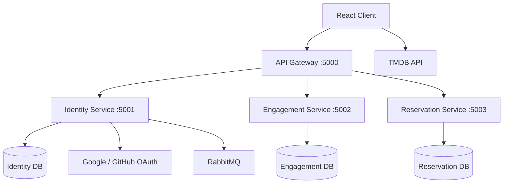
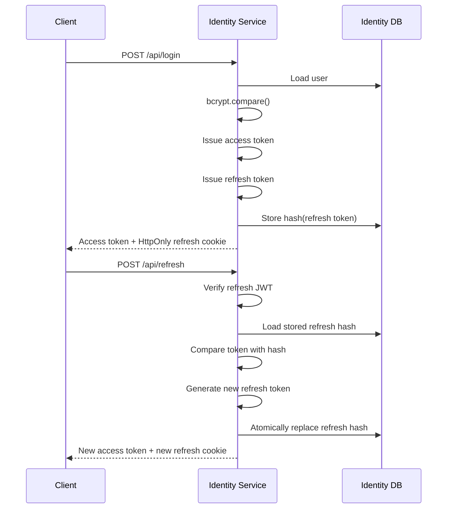
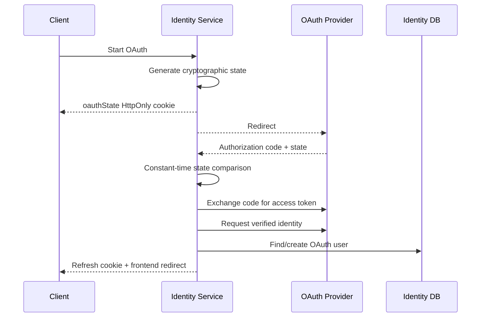
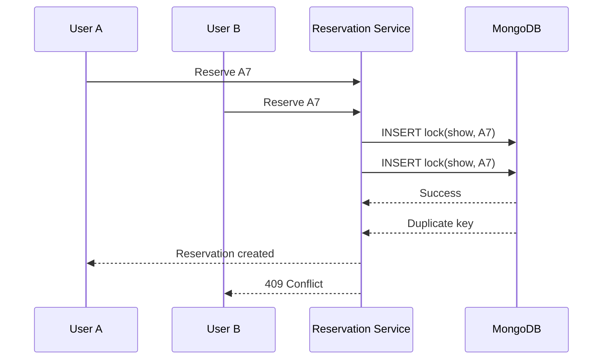

# Movie Reservation System

A full-stack movie booking platform built around **Domain-Driven Design, independently deployable backend services, secure authentication, and concurrency-safe seat reservation**.

The system consists of a React frontend, an API Gateway, and three domain-oriented backend services:

* **Identity** — authentication, profiles, OAuth, access/refresh tokens
* **Reservation** — booking lifecycle and concurrency-safe seat allocation
* **Engagement** — movie likes and comments

The backend is written primarily in **TypeScript** and organized using **DDD / Ports and Adapters principles**, with explicit domain, application, infrastructure, and presentation boundaries.

**Live demo:**
https://movie-reservation-1-4uao.onrender.com

**Repository:**
https://github.com/ML642/movie-reservation

---

## Highlights

This project focuses on backend architecture rather than only CRUD functionality.

Key engineering features include:

* Domain-Driven Design with bounded modules
* API Gateway routing to independently runnable services
* Database-per-service logical separation
* Repository ports with MongoDB adapters
* Dependency injection through composition roots
* 15-minute JWT access tokens
* Rotating 30-day refresh tokens
* HttpOnly refresh-token cookies
* Hashed refresh tokens stored in MongoDB
* Refresh-token replay protection
* Google OAuth 2.0
* GitHub OAuth 2.0
* OAuth state validation
* bcrypt password hashing
* RabbitMQ domain-event publishing
* MongoDB transactions where supported
* Database-level protection against double booking
* Compensating rollback for non-transactional MongoDB deployments
* Owner-based authorization
* Unit, presentation, persistence, and integration tests
* Dockerized multi-service local environment

---

# Architecture



The API Gateway is the public backend entry point.

```text
Client
  |
  v
API Gateway :5000
  |
  +-- /api/register
  +-- /api/login
  +-- /api/refresh
  +-- /api/oauth/*
  |       |
  |       +----> Identity Service :5001
  |
  +-- /api/likes/*
  +-- /api/comments/*
  |       |
  |       +----> Engagement Service :5002
  |
  +-- /api/reservation/*
          |
          +----> Reservation Service :5003
```

The Gateway performs prefix-based routing and centralizes public CORS handling while the services remain independently runnable.

---

# Backend Service Boundaries

## Identity Service

Responsible for:

* registration;
* password login;
* user profiles;
* profile updates;
* access-token generation;
* refresh-token rotation;
* Google OAuth;
* GitHub OAuth;
* publishing identity domain events.

Default development port:

```text
5001
```

---

## Engagement Service

Responsible for:

* liked movies;
* comments;
* comment ownership;
* like uniqueness.

Default development port:

```text
5002
```

---

## Reservation Service

Responsible for:

* seat availability;
* reservation creation;
* reservation history;
* reservation cancellation;
* ownership validation;
* concurrent booking protection.

Default development port:

```text
5003
```

---

## API Gateway

The Gateway exposes the backend through one public endpoint.

Default development port:

```text
5000
```

It proxies traffic according to the requested domain:

```text
/api/likes*        -> Engagement
/api/comments*     -> Engagement
/api/reservation*  -> Reservation
everything else    -> Identity
```

A service communication failure is converted to:

```http
502 Bad Gateway
```

---

# Domain-Driven Design

Each backend domain follows the same dependency direction:

```text
Presentation
     |
     v
Application
     |
     v
Domain

Infrastructure
     |
     v
Application Ports
```

The domain and application layers do not depend directly on Express or Mongoose.

A typical module looks like:

```text
module/
├── domain/
├── application/
│   └── ports/
├── Infrastructure/
├── presentation/
└── compositionRoot.ts
```

---

## Domain Layer

The domain layer contains business rules and domain-specific errors.

Examples include:

```text
Identity/domain/
    user.ts
    IdentityError.ts

Engagement/domain/
    comment.ts
    like.ts
    EngagementError.ts

reservation/domain/
    reservation.ts
    ReservationError.ts
```

Examples of rules implemented at this level:

* email normalization;
* username normalization;
* reservation input validation;
* seat normalization;
* deterministic show identity;
* reservation ownership;
* comment validation;
* like validation.

No MongoDB models are needed for these rules.

---

## Application Layer

Application services coordinate use cases.

```text
IdentityService
EngagementService
ReservationService
```

They depend on abstractions rather than concrete persistence implementations.

For example:

```text
ReservationService
       |
       v
ReservationRepository
       ^
       |
MongoReservationRepository
```

The application layer therefore does not need to know that MongoDB is being used.

---

## Ports

Infrastructure dependencies are represented using TypeScript interfaces.

Examples include:

```text
UserRepository
PasswordHasher
TokenProvider
OAuthProvider
EventPublisher

EngagementRepository

ReservationRepository
```

This provides dependency inversion:

```text
business logic
      |
      v
interface / port
      ^
      |
infrastructure adapter
```

It also allows application services to be unit-tested using in-memory or mocked implementations.

---

## Infrastructure Layer

Infrastructure implements the application ports.

Examples:

```text
MongoUserRepository
MongoEngagementRepository
MongoReservationRepository

BcryptPasswordHasher
JwtTokenProvider
HttpOAuthProvider
RabbitMqEventPublisher
```

Framework-specific implementation details remain outside the domain.

---

## Presentation Layer

The presentation layer contains Express-specific code:

* routes;
* authentication middleware;
* controllers;
* HTTP status mapping;
* request parsing;
* response formatting.

The flow is:

```text
HTTP Request
     |
     v
Route
     |
     v
Controller
     |
     v
Application Service
     |
     v
Repository Port
     |
     v
Infrastructure Adapter
```

---

# Composition Roots

Every domain has a dedicated composition root.

For example, the Reservation composition root wires together:

```text
ReservationModel
BookedSeatModel
        |
        v
MongoReservationRepository
        |
        v
ReservationService
        |
        v
ReservationController
        |
        v
ReservationRoutes
```

Dependency construction is therefore kept outside domain and application logic.

This makes dependencies explicit and avoids importing concrete database implementations throughout the business layer.

---

# Deployment Topology Is Separate from Domain Architecture

The DDD modules themselves are not coupled to a particular deployment model.

The repository supports assembling the same modules in two ways.

### Distributed service mode

```text
Gateway
  |
  +--> Identity Service
  +--> Engagement Service
  +--> Reservation Service
```

This is the topology used by the Docker Compose architecture.

### Single-process composition

`server/app.js` can also compose the same modules into one Express application.

```text
Express
  |
  +--> Identity Module
  +--> Engagement Module
  +--> Reservation Module
```

This demonstrates an important architectural property:

> Domain boundaries exist independently from process boundaries.

The business modules do not need to be rewritten when the deployment topology changes.

---

# Authentication Architecture

Authentication uses short-lived access tokens together with rotating refresh tokens.



---

## Access Tokens

Access tokens are JWTs with:

```text
tokenType = access
expiration = 15 minutes
```

Protected services verify the access token before executing user-specific operations.

The frontend automatically sends:

```http
Authorization: Bearer <access-token>
```

---

## Refresh Tokens

Refresh tokens use:

```text
tokenType = refresh
expiration = 30 days
```

They are stored by the browser as:

```text
HttpOnly
Secure in production
SameSite=None in production
```

The raw refresh token is not stored in MongoDB.

Instead:

```text
refresh token
     |
     v
bcrypt
     |
     v
refreshTokenHash
```

The hash is stored in the Identity database.

---

## Refresh Token Rotation

Every successful refresh generates a new refresh token.

The repository performs an atomic replacement:

```text
expected previous hash
        |
        v
MongoDB conditional update
        |
        +--> match    -> replace with new hash
        |
        +--> no match -> token already replaced
```

This prevents the same refresh token from being successfully reused after rotation.

If the compare-and-replace operation fails, authentication is rejected.

---

# Password Security

Passwords are hashed using bcrypt with a work factor of:

```text
12
```

Passwords are never returned as part of public user objects.

Authentication operates through the `PasswordHasher` port, keeping bcrypt outside the domain layer.

---

# OAuth 2.0

The Identity service supports:

```text
Google
GitHub
```

Routes:

```http
GET /api/oauth/google
GET /api/oauth/google/callback

GET /api/oauth/github
GET /api/oauth/github/callback
```

---

## OAuth Flow



The implementation performs server-side authorization-code exchange rather than trusting identity information from the frontend.

---

## OAuth State Protection

Before redirecting the browser, the service generates a random state value.

The state is stored in an HttpOnly cookie and compared when the provider returns.

Comparison uses constant-time comparison to reduce timing-based leakage.

---

## Verified OAuth Identity

Google authentication requires a verified Google email.

GitHub authentication requests the user's verified email addresses and prefers:

1. primary + verified;
2. verified;
3. provider-returned email.

OAuth accounts are identified by:

```text
provider + provider subject
```

MongoDB enforces uniqueness on this pair.

---

## Account Collision Policy

An OAuth login is not silently merged into an existing password account that has the same email address.

Instead, the Identity domain rejects the OAuth login and requires the existing account to be authenticated first.

This avoids automatically joining two authentication identities based only on matching email strings.

---

# Reservation Domain

The Reservation service contains the most consistency-sensitive part of the application.

A reservation represents:

```text
Reservation
├── id
├── userId
├── movieId
├── theaterId
├── seats[]
├── showtime
├── bookingDate
├── showKey
├── price
├── movie metadata
└── status
```

The domain normalizes duplicate seats before persistence.

For example:

```text
["A1", "A1", "A2"]
```

becomes:

```text
["A1", "A2"]
```

---

# Show Identity

Seat ownership must be unique for one specific showing rather than only one movie.

The system creates a deterministic `showKey` from:

```text
movieId
+
theaterId
+
normalized date
+
showtime
```

Conceptually:

```text
movieId::theaterId::YYYY-MM-DD::showtime
```

A seat is therefore identified for booking purposes by:

```text
(showKey, seatId)
```

---

# Concurrency-Safe Seat Booking

The key reservation invariant is:

> The same seat cannot belong to two reservations for the same show.

Application-level checks alone cannot guarantee this.

Consider two concurrent requests:

```text
Request A checks A7 -> available
Request B checks A7 -> available

Request A reserves A7
Request B reserves A7
```

A normal:

```text
check
then
insert
```

flow has a race condition.

The system instead uses MongoDB as the final concurrency authority.

---

## Database Seat Lock

Every reserved seat creates a `BookedSeat` document.

The database has a compound unique index:

```javascript
{ showKey: 1, seatId: 1 }
```

with:

```text
unique = true
```

This creates the database invariant:

```text
UNIQUE(showKey, seatId)
```

---

## Concurrent Booking Flow



Only one request can win.

The losing request receives:

```http
409 Conflict
```

together with the conflicting seat identifiers.

---

# Transaction-Aware Reservation Persistence

When MongoDB supports transactions, reservation creation executes the following operations in one transaction:

```text
BEGIN

create seat locks
create reservation

COMMIT
```

Similarly, cancellation performs:

```text
BEGIN

delete seat locks
mark reservation cancelled

COMMIT
```

This keeps reservation records and seat ownership synchronized.

---

## Standalone MongoDB Fallback

MongoDB transactions require a replica set or sharded deployment.

The repository checks whether transactions are available.

If they are unavailable, it uses a compensating strategy.

Reservation creation becomes:

```text
1. create seat locks
2. create reservation
3. if reservation creation fails:
      remove locks created for that reservation
```

The unique database index still remains the final protection against double booking.

This means concurrency safety does not depend on a process-local mutex.

---

# Why There Is No In-Memory Seat Lock

Using:

```text
Set
Map
mutex
```

inside a Node.js process would only protect one server instance.

With two Reservation instances:

```text
Reservation Instance A
        |
        |
        v
      MongoDB
        ^
        |
        |
Reservation Instance B
```

instance A cannot see process memory belonging to instance B.

Database-enforced uniqueness works across all service instances.

This allows the Reservation service to scale horizontally without losing the seat-allocation invariant.

---

# Reservation Failure Policy

Reservation persistence fails closed.

If MongoDB is unavailable, the service does not create an unsafe temporary reservation in local process memory.

Instead it reports storage unavailability.

For reservation systems:

```text
rejecting one booking
```

is safer than:

```text
selling the same seat twice
```

---

# Reservation Ownership

Reservation cancellation validates ownership inside the domain/application workflow.

A user cannot cancel another user's reservation by providing its identifier.

---

# Engagement Domain

The Engagement service contains functionality that belongs to user interaction rather than booking.

It currently manages:

```text
Likes
Comments
```

This keeps social behavior separated from the Reservation domain.

---

## Likes

Likes are persisted with:

```text
userId
movieKey
```

MongoDB contains:

```text
UNIQUE(userId, movieKey)
```

preventing a user from creating duplicate likes for the same movie.

---

## Comments

Comment reading is public.

Comment creation requires authentication.

Comment modification requires ownership.

```text
GET     comment       -> public
POST    comment       -> authenticated
PATCH   comment       -> owner
DELETE  comment       -> owner
```

Ownership validation is performed by the backend rather than trusting client-supplied identity.

---

# Domain Events and RabbitMQ

The Identity application depends on an `EventPublisher` port rather than directly depending on RabbitMQ.

```text
IdentityService
      |
      v
EventPublisher
      ^
      |
RabbitMqEventPublisher
```

When a new user is created, Identity publishes:

```text
identity.user.registered
```

The event contains:

```json
{
  "name": "identity.user.registered",
  "occurredAt": "...",
  "payload": {
    "userId": "..."
  }
}
```

RabbitMQ uses a durable topic exchange:

```text
domain-events
```

and publishes messages as persistent JSON messages.

This provides infrastructure for future asynchronous consumers such as:

* notifications;
* analytics;
* onboarding;
* audit logging.

The current repository implements the publisher side; it does not pretend that every service interaction is already event-driven.

When RabbitMQ is not configured, the Identity module can use a no-op event publisher, keeping the core application independent from the broker.

---

# Database Ownership

The Docker Compose environment gives each backend service its own logical database:

```text
Identity     -> mongodb://mongo:27017/identity
Engagement   -> mongodb://mongo:27017/engagement
Reservation  -> mongodb://mongo:27017/reservation
```

All databases may run inside the same MongoDB container locally, but service ownership remains separated.

This avoids direct cross-domain collection access.

```text
Identity Service
      |
      +----> Identity DB

Engagement Service
      |
      +----> Engagement DB

Reservation Service
      |
      +----> Reservation DB
```

A service owns its persistence model.

---

# Frontend Architecture

The frontend is built with:

* React 19
* React Router
* TanStack React Query
* Zod
* Fetch / Axios
* Framer Motion
* TMDB API

Responsibilities are separated between:

```text
pages/
components/
hooks/
config/
utils/
```

Movie catalog information comes from TMDB.

Application-owned state such as users, comments, likes, and reservations comes from the backend.

---

# Frontend Authentication Flow

The frontend keeps the short-lived access token in browser storage and uses the refresh token through an HttpOnly cookie.

Protected requests go through an authentication-aware request wrapper:

```text
request
   |
   v
attach access token
   |
   v
backend
   |
   +---- success -> return response
   |
   +---- 401
          |
          v
       POST /api/refresh
          |
          +---- success -> store new access token
          |              retry original request
          |
          +---- failure -> remain unauthorized
```

Multiple simultaneous refresh attempts are collapsed through a shared refresh promise so the frontend does not unnecessarily perform multiple concurrent refresh requests.

---

# API Endpoints

Public gateway URL during local development:

```text
http://localhost:5000
```

---

## Identity

```http
POST  /api/register
POST  /api/login
POST  /api/refresh

GET   /api/oauth/:provider
GET   /api/oauth/:provider/callback

POST  /api/userInfo
PATCH /api/changeInfo

GET   /api/test
```

Supported OAuth providers:

```text
google
github
```

---

## Reservations

```http
GET    /api/reservation/seats

POST   /api/reservation
GET    /api/reservation/all
POST   /api/reservation/id
DELETE /api/reservation/delete/:id
```

All reservation mutation/history endpoints require authentication.

Seat availability can be queried without authentication.

---

## Likes

```http
GET    /api/likes
POST   /api/likes
DELETE /api/likes
DELETE /api/likes/:movieKey
```

All like endpoints require authentication.

---

## Comments

```http
GET    /api/comments/:movieId
POST   /api/comments/:movieId
PATCH  /api/comments/:commentId
DELETE /api/comments/:commentId
```

Only comment reads are public.

---

# HTTP Error Semantics

The backend uses domain-specific errors and maps them to HTTP responses.

Examples:

```text
400  Invalid domain input
401  Authentication failure
403  Ownership / authorization failure
404  Resource not found
409  Seat reservation conflict
503  Required persistence unavailable
502  Gateway could not reach service
500  Unexpected server failure
```

Domain exceptions remain independent from HTTP while controllers perform protocol-level mapping.

---

# Repository Structure

```text
movie-reservation/
│
├── frontend/
│   ├── src/
│   ├── Dockerfile
│   └── package.json
│
├── server/
│   │
│   ├── gateway.js
│   ├── app.js
│   ├── server.js
│   ├── Dockerfile
│   ├── jest.config.cjs
│   │
│   ├── services/
│   │   ├── common.js
│   │   ├── jwtVerifier.js
│   │   ├── identity.js
│   │   ├── engagement.js
│   │   └── reservation.js
│   │
│   └── src/
│       │
│       ├── modules/
│       │   │
│       │   ├── Identity/
│       │   │   ├── domain/
│       │   │   ├── application/
│       │   │   │   └── ports/
│       │   │   ├── Infrastructure/
│       │   │   │   ├── database/
│       │   │   │   ├── security/
│       │   │   │   ├── oauth/
│       │   │   │   └── messaging/
│       │   │   ├── presentation/
│       │   │   └── compositionRoot.ts
│       │   │
│       │   ├── Engagement/
│       │   │   ├── domain/
│       │   │   ├── application/
│       │   │   │   └── ports/
│       │   │   ├── Infrastructure/
│       │   │   │   └── database/
│       │   │   ├── presentation/
│       │   │   └── compositionRoot.ts
│       │   │
│       │   └── reservation/
│       │       ├── domain/
│       │       ├── application/
│       │       │   └── ports/
│       │       ├── Infrastructure/
│       │       │   └── database/
│       │       ├── presentation/
│       │       └── compositionRoot.ts
│       │
│       └── shared/
│           └── Infrastructure/
│               └── database/
│
└── docker-compose.yml
```

---

# Technology Stack

## Frontend

```text
React 19
React Router
TanStack React Query
Zod
Framer Motion
TMDB API
```

## Backend

```text
Node.js
TypeScript
Express 5
JWT
bcrypt
Mongoose
```

## Infrastructure

```text
MongoDB 7
RabbitMQ
Docker
Docker Compose
API Gateway
```

## Authentication

```text
JWT access tokens
Rotating refresh tokens
HttpOnly cookies
Google OAuth 2.0
GitHub OAuth 2.0
```

## Testing

```text
Jest
SWC/Jest
Application-service unit tests
Controller/route tests
Repository integration tests
Database infrastructure tests
```

---

# Testing Strategy

Backend tests are colocated with their architectural layers.

Examples include:

```text
Identity/application/__tests__/
Identity/presentation/__tests__/

Engagement/application/__tests__/
Engagement/Infrastructure/database/repositories/__tests__/

reservation/application/__tests__/
reservation/Infrastructure/database/repositories/__tests__/

shared/Infrastructure/database/__tests__/
```

This allows different concerns to be tested independently.

---

## Application Tests

Application services can be tested without HTTP or MongoDB because they depend on ports.

Typical test boundary:

```text
Application Service
       |
       v
Mock Repository
```

This validates business use cases without infrastructure.

---

## Presentation Tests

Identity contains dedicated controller and route tests covering behavior such as:

* registration;
* login;
* refresh;
* profile retrieval;
* profile updates;
* authentication middleware.

---

## Persistence Integration Tests

MongoDB repository tests cover infrastructure-specific behavior separately from application tests.

Reservation persistence tests verify database behavior around booking and locks.

---

## Running Backend Tests

```bash
cd server
npm install
npm test
```

The test command first builds the TypeScript modules and then executes Jest.

---

# Build

Backend DDD modules are compiled independently:

```bash
npm run build:shared
npm run build:identity
npm run build:engagement
npm run build:reservation
```

Or all at once:

```bash
npm run build
```

This produces compiled service modules used by the Node.js runtime entrypoints.

---

# Running with Docker Compose

The repository contains a multi-service Docker Compose environment.

Infrastructure:

```text
gateway
identity
engagement
reservation
mongo
rabbitmq
```

Start it with:

```bash
docker compose up --build
```

Default service ports:

```text
Gateway      5000
Identity     5001
Engagement   5002
Reservation  5003
RabbitMQ UI  15672
```

The internal services communicate through Docker DNS names such as:

```text
http://identity:5001
http://engagement:5002
http://reservation:5003
mongodb://mongo:27017/...
amqp://rabbitmq:5672
```

For browser access from a separately running frontend, configure the Gateway's `CORS_ORIGINS` with the frontend origin.

---

# Running the Frontend

```bash
cd frontend
npm install
npm start
```

Default development URL:

```text
http://localhost:3000
```

Create:

```text
frontend/.env
```

with:

```env
REACT_APP_TMDB_API_KEY=your_tmdb_api_key
REACT_APP_API_URL=http://localhost:5000
```

---

# Backend Environment Variables

## Common

```env
JWT_SECRET=replace_with_a_strong_secret
CORS_ORIGINS=http://localhost:3000
```

---

## Gateway

```env
PORT=5000

IDENTITY_SERVICE_URL=http://localhost:5001
ENGAGEMENT_SERVICE_URL=http://localhost:5002
RESERVATION_SERVICE_URL=http://localhost:5003

CORS_ORIGINS=http://localhost:3000
```

---

## Identity Service

```env
PORT=5001

MONGODB_URI=mongodb://localhost:27017/identity
JWT_SECRET=replace_with_a_strong_secret

FRONTEND_URL=http://localhost:3000

RABBITMQ_URL=amqp://localhost:5672
```

Optional Google OAuth:

```env
GOOGLE_OAUTH_CLIENT_ID=
GOOGLE_OAUTH_CLIENT_SECRET=
GOOGLE_OAUTH_REDIRECT_URI=http://localhost:5000/api/oauth/google/callback
```

Optional GitHub OAuth:

```env
GITHUB_OAUTH_CLIENT_ID=
GITHUB_OAUTH_CLIENT_SECRET=
GITHUB_OAUTH_REDIRECT_URI=http://localhost:5000/api/oauth/github/callback
```

---

## Engagement Service

```env
PORT=5002

MONGODB_URI=mongodb://localhost:27017/engagement
JWT_SECRET=replace_with_a_strong_secret
```

---

## Reservation Service

```env
PORT=5003

MONGODB_URI=mongodb://localhost:27017/reservation
JWT_SECRET=replace_with_a_strong_secret
```

---

# Architectural Decisions

## Why DDD-style modules?

Authentication, engagement, and reservation have different business rules.

Keeping them in one generic:

```text
controllers/
services/
models/
```

structure makes domain boundaries increasingly unclear as the project grows.

The current architecture instead organizes code first by business capability and then by technical layer.

```text
modules/
    Identity/
    Engagement/
    reservation/
```

This keeps related business behavior together.

---

## Why repository ports?

Application code should express business use cases rather than MongoDB queries.

Instead of:

```text
ReservationService -> Mongoose
```

the dependency is:

```text
ReservationService
       |
       v
ReservationRepository
       ^
       |
MongoReservationRepository
```

This improves:

* testability;
* dependency inversion;
* infrastructure replaceability;
* architectural clarity.

---

## Why separate service databases?

Allowing services to directly modify each other's collections creates hidden coupling.

Logical database ownership means:

```text
Identity owns identity data
Engagement owns engagement data
Reservation owns reservation data
```

Cross-domain behavior should happen through APIs or events rather than foreign collection access.

---

## Why an API Gateway?

Without a Gateway, the frontend would need to know:

```text
Identity URL
Reservation URL
Engagement URL
```

Instead, the client knows one backend address.

The Gateway determines the destination service.

This isolates the frontend from backend deployment topology.

---

## Why short-lived access tokens?

Access tokens are frequently sent to APIs.

Keeping them short-lived limits the lifetime of a leaked token.

Refresh credentials live longer but are placed in HttpOnly cookies and rotated.

---

## Why hash refresh tokens?

A database compromise should not immediately reveal reusable long-lived refresh credentials.

The system stores:

```text
bcrypt(refreshToken)
```

instead of the raw token.

---

## Why database-enforced seat locks?

Reservation correctness must survive:

* concurrent HTTP requests;
* multiple Node.js processes;
* horizontal scaling;
* server restarts.

A process-local lock cannot provide that guarantee.

A database unique index can.

---

## Why RabbitMQ behind a port?

The Identity application should know that an event must be published.

It should not know how RabbitMQ channels, exchanges, or connections work.

This keeps messaging infrastructure replaceable and makes the application service testable without a broker.

---

# Current Scope

The project intentionally concentrates on architectural backend concerns rather than implementing every component of a commercial cinema platform.

Current scope includes:

* movie discovery through TMDB;
* user identity;
* Google/GitHub OAuth;
* secure token refresh;
* likes;
* comments;
* seat selection;
* reservation persistence;
* reservation conflict handling;
* cancellation;
* domain events;
* multi-service deployment.

Not currently implemented:

* payment processing;
* cinema administration;
* real theater inventory synchronization;
* temporary pre-payment seat holds;
* notification consumers for RabbitMQ events;
* distributed tracing;
* centralized observability;
* production orchestration such as Kubernetes.

These are possible extension points rather than required dependencies of the current architecture.

---

# Possible Future Work

Potential next steps include:

* Redis-backed temporary seat holds with expiration;
* payment provider integration;
* transactional outbox for guaranteed event publishing;
* RabbitMQ notification consumers;
* OpenAPI documentation;
* centralized structured logging;
* distributed tracing;
* rate limiting;
* service-level metrics;
* CI/CD;
* contract testing between Gateway and services;
* stronger request schemas across backend endpoints;
* Dockerized frontend in the main Compose environment;
* Kubernetes deployment manifests.

---

# What This Project Demonstrates

From an engineering perspective, the project demonstrates:

```text
Domain-Driven Design
Ports and Adapters
Dependency Inversion
Repository Pattern
Composition Roots
Service Decomposition
API Gateway Pattern
Database Ownership
OAuth 2.0
JWT Authentication
Refresh Token Rotation
Secure Cookie Handling
Domain Events
RabbitMQ
MongoDB Transactions
Concurrency Control
Database Invariants
Compensating Transactions
Authorization
Integration Testing
Dockerized Infrastructure
```

The most important design goal is not simply to make the application work under normal conditions, but to preserve domain invariants when requests overlap, infrastructure changes, or the backend is split across multiple processes.

In particular, reservation correctness ultimately depends on the persistent invariant:

```text
UNIQUE(showKey, seatId)
```

rather than on timing assumptions inside Node.js.

That allows the system to remain correct even when multiple reservation requests are processed concurrently by independently running backend instances.
