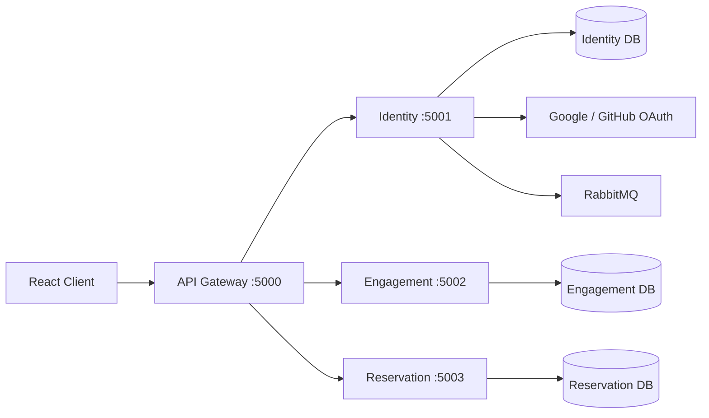

# Movie Reservation System

A full-stack movie booking platform focused on **backend architecture, secure authentication, and concurrency-safe seat reservation**.

[Live Demo](https://movie-reservation-1-4uao.onrender.com)

## Highlights

- Domain-Driven Design with **Ports and Adapters**
- API Gateway with independently runnable **Identity**, **Engagement**, and **Reservation** services
- JWT access tokens with **rotating hashed refresh tokens** and replay protection
- **Google and GitHub OAuth 2.0** with state validation
- RabbitMQ-based domain-event publishing
- Database-level protection against **double booking**
- MongoDB transactions with a compensating fallback for standalone deployments
- Unit, presentation, persistence, integration, and gateway tests
- Docker Compose environment for the backend services

## Architecture



The backend modules follow the same dependency direction:

```text
Presentation -> Application -> Domain
                     ^
                     |
              Infrastructure
```

Business logic depends on repository and service interfaces rather than directly on Express or Mongoose implementations.

## Services

| Service | Responsibility | Port |
| --- | --- | ---: |
| API Gateway | Routes requests to backend services | 5000 |
| Identity | Authentication, profiles, OAuth, tokens | 5001 |
| Engagement | Likes and comments | 5002 |
| Reservation | Seat availability, booking, cancellation | 5003 |

## Concurrency-Safe Reservations

The main consistency rule is that the same seat cannot be reserved twice for the same showing.

Each booked seat is protected by a MongoDB unique index:

```javascript
{ showKey: 1, seatId: 1 }
```

`showKey` is derived from the movie, theater, date, and showtime. Concurrent requests for the same seat therefore race at the database level, where only one insert can succeed; the losing request receives `409 Conflict`.

When transactions are available, seat locks and reservations are written atomically. On standalone MongoDB deployments, the repository uses compensating rollback while keeping the unique index as the final concurrency guarantee.

## Authentication

The Identity service uses:

- 15-minute JWT access tokens
- 30-day rotating refresh tokens
- HttpOnly refresh-token cookies
- bcrypt-hashed refresh tokens in MongoDB
- atomic refresh-token replacement to prevent replay
- bcrypt password hashing
- Google OAuth 2.0
- GitHub OAuth 2.0
- OAuth state validation

## Tech Stack

**Frontend:** React, React Router, TanStack Query, Axios, Framer Motion  
**Backend:** TypeScript, Node.js, Express  
**Data & Messaging:** MongoDB, Mongoose, RabbitMQ  
**Auth:** JWT, bcrypt, Google OAuth, GitHub OAuth  
**Testing:** Jest, Node test runner  
**Infrastructure:** Docker, Docker Compose

## Running Locally

### Backend with Docker Compose

Create a `.env` file in the repository root with the required secrets:

```env
JWT_SECRET=your-secret
GOOGLE_OAUTH_CLIENT_ID=...
GOOGLE_OAUTH_CLIENT_SECRET=...
GOOGLE_OAUTH_REDIRECT_URI=...
GITHUB_OAUTH_CLIENT_ID=...
GITHUB_OAUTH_CLIENT_SECRET=...
```

Then run:

```bash
docker compose up --build
```

The API Gateway will be available at `http://localhost:5000`.

### Frontend

```bash
cd frontend
npm install
npm start
```

The frontend runs at `http://localhost:3000` by default.

## Tests

```bash
cd server
npm install
npm test
```

The test command builds the TypeScript modules and runs gateway and backend test suites.
