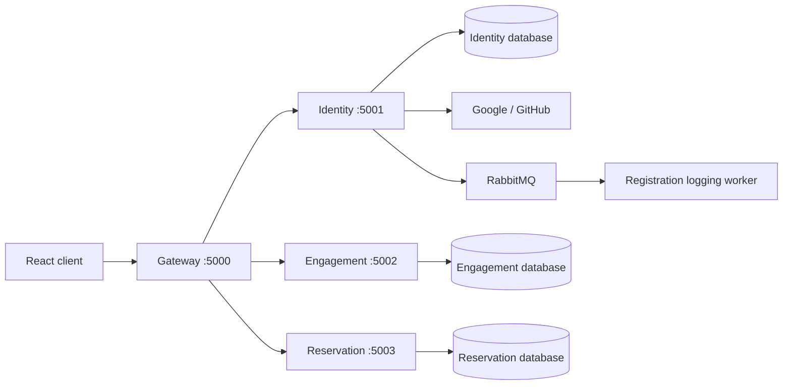

# Architecture

CineReserve uses a public HTTP gateway, three backend API processes, and a registration-event worker. Docker Compose runs these processes as separate containers. The services share the backend package and build pipeline.



Compose uses three databases on the same MongoDB instance. The ports below are container ports; only the gateway API port is published to the host.

| Process | Responsibility | Gateway routes |
| --- | --- | --- |
| Gateway | Routing, CORS, upstream errors | Public entry point |
| Identity | Accounts, OAuth, JWT sessions | Default upstream, including `/api/login` and `/api/register` |
| Engagement | Favorites and comments | `/api/likes`, `/api/comments` |
| Reservation | Availability, bookings, cancellation | `/api/reservation` |
| Registration worker | Registration event logging | No HTTP endpoint |

## Module boundaries

Each backend module separates presentation, application, domain, and infrastructure code. Composition roots connect Express controllers, application ports, and MongoDB adapters. Domain and application code do not directly import Express or Mongoose.

```text
Presentation -> Application -> Domain
                    ^
                    |
             Infrastructure
```

## Seat ownership

MongoDB enforces a unique index on `{ showKey: 1, seatId: 1 }` in the booked-seat collection. A show key combines movie, theater, date, and time. Competing reservations for the same show/seat conflict at the database level and are mapped to HTTP `409`.

On replica sets, reservation records and seat locks are written in a transaction. On standalone MongoDB, the repository uses compensating cleanup when reservation creation fails. Cancellation releases the seat locks.

## Authentication

Identity issues 15-minute access JWTs and 30-day refresh JWTs. Refresh tokens are kept in HttpOnly cookies, with hashes stored in MongoDB. Google and GitHub sign-in use authorization-code exchange and a state cookie.

## Registration events

Identity publishes `identity.user.registered` when `RABBITMQ_URL` is configured. The publisher declares the durable `registration-audit` queue and its topic binding before publishing a persistent message, then waits for broker confirmation.

The worker validates the event, logs the user ID and event timestamp, and acknowledges it. When RabbitMQ is not configured, Identity uses a no-op publisher.

## Implementation limits

- Refresh-token replacement uses a conditional database update, but full JWTs are compared through bcrypt. Its input-length limit and refresh JWTs without unique IDs mean replay prevention is not reliable yet.
- Standalone MongoDB cleanup is not equivalent to an atomic transaction. A process crash can leave inconsistent reservation/lock state.
- The worker has no persistent audit store or deduplication. Redelivery can produce duplicate logs. Invalid events and logging failures are rejected without requeue; no dead-letter queue is configured.
- Event publication happens after user creation and has no transactional outbox. A broker failure can leave a created user without a successfully published event.
- Gateway `/api/health` checks only the gateway process. It does not establish readiness of the backend services or MongoDB.

[Back to README](../README.md)
